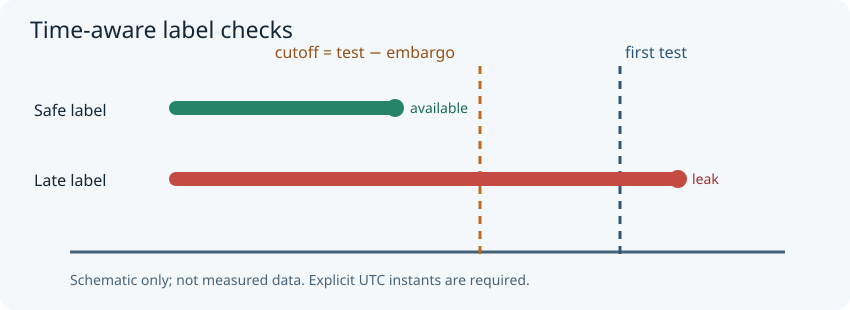

# Fold Sentry

*Audit the split before you trust the score.*

| Topic | Details |
| --- | --- |
| Status | Development preview; unreleased version 0.1.0 |
| Runtime | Python 3.10+; no runtime dependencies |
| License | [MIT](LICENSE) |
| Documentation | [Usage](#usage) · [Audit rules](#audit-rules) · [Limitations](#assumptions-and-limitations) |
| Examples | [Clean](examples/clean.csv) · [Deliberately leaky](examples/leaky.csv) |
| Tests | [Local test command](#contributing) · [GitHub Actions configuration](.github/workflows/test.yml) |
| Citation | [How to cite](#citing) |

**Fold Sentry** is a small, read-only preflight tool for *already-created* ML train/test split manifests. It catches four observable boundary mistakes: duplicate sample IDs within a fold, entity/group overlap, training features at or after the first test timestamp, and training labels unavailable at the declared evaluation boundary. It is aimed at environmental, energy, time-series and grouped ML evaluation where impressive scores can conceal invalid splits.

It is **not** a new cross-validation splitter. [scikit-learn's `TimeSeriesSplit`](https://scikit-learn.org/stable/modules/generated/sklearn.model_selection.TimeSeriesSplit.html) creates time-aware folds; [blockCV](https://github.com/rvalavi/blockCV) creates spatially separated folds. Fold Sentry instead audits a portable CSV *after* a split is assigned, with explicit label-availability times and a machine-readable result. These are complementary approaches, not a claim of unique algorithms. [Roberts et al. (2017)](https://doi.org/10.1111/ecog.02881) discuss the broader challenge of dependence in model evaluation.

## Installation

From a checkout:

```sh
python -m pip install -e .
```

## Usage

Each CSV row describes one observation assigned to one `fold` and one `role` (`train` or `test`). The six required columns are `fold,role,sample_id,group_id,feature_at_utc,label_available_utc`. Extra columns are ignored. Identifiers are strings. Both timestamps must be ISO 8601 with `Z` or an explicit offset; they are normalized to UTC. `feature_at_utc` is the timestamp at which the model would make the prediction, and `label_available_utc` is the earliest instant its ground-truth label would be known. These times are **asserted by the manifest author**; the tool cannot infer them from raw features or target engineering.

```sh
python -m fold_sentry examples/clean.csv --embargo-hours 2
```

Expected: JSON with `"status": "PASS"`, `"rows": 6`, `"findings": []`; exit code **0**. To inspect deliberately invalid boundaries:

```sh
python -m fold_sentry examples/leaky.csv --embargo-hours 2
```

Expected: JSON `"status": "FAIL"` and findings `DUPLICATE_SAMPLE`, `GROUP_OVERLAP`, `LABEL_NOT_AVAILABLE`, `TRAIN_NOT_BEFORE_TEST`; exit code **1**. Invalid input, malformed UTC timestamps, or invalid configuration produce JSON `"status": "ERROR"` on stderr and exit code **2**. CLI output is deterministic for identical input and options. The tool never edits the manifest.

### Group-policy choice

The default `--group-policy disjoint` is for evaluating **unseen entities** (different sites, patients, devices, watersheds, etc.). For a **known-entity future forecast**, the same entity may legitimately appear in train and test; explicitly choose `--group-policy allow` to suppress only `GROUP_OVERLAP`. All time and label checks remain active. Neither mode determines whether the chosen evaluation design matches deployment.

### Audit rules



*Illustrative diagram, not experimental data. A training label that becomes available after the cutoff is not valid for a model evaluated at the first test instant.*

For each fold independently, the tool computes `first_test = min(test.feature_at_utc)` and `label_cutoff = first_test − embargo_hours` (default zero). It flags a training row when `train.feature_at_utc >= first_test` or `train.label_available_utc > label_cutoff`. Equality at the label cutoff is allowed; equality at the first test prediction timestamp is **not** allowed for training features. An embargo is a duration in **hours**, not a count of samples. Group overlap and duplicate sample IDs are checked independently; a sample may legitimately appear in *different* cross-validation folds. The JSON includes fold counts, cutoffs, issue counts and up to five sorted identifier examples per issue (configurable).

## Assumptions and limitations

- This is a **manifest audit**, not a guarantee against data leakage. It cannot detect feature engineering on the full dataset, preprocessing fitted before splitting, target-derived features, spatial dependence among *different* groups, or incorrect declared timestamps. Source data, prediction horizon and deployment assumptions still need human review.
- Label availability must be recorded honestly. `label_available_utc` must be at or after `feature_at_utc`; the tool intentionally targets prospective-label tasks, not retrospective classification with already-known labels.
- Fold labels are independent; this tool does not enforce a specific K-fold partition design or validate model predictions. All train rows must precede the *earliest* test instant, so it targets forward-in-time evaluation, not symmetric blocked CV.
- Group IDs are exact strings, not geographic buffers or hierarchical group matching. For spatial prediction, use an appropriate spatial blocking method and examine residual spatial autocorrelation.
- All CSV rows are held in memory; do not use for huge or untrusted multi-GB manifests. The output includes example sample/group identifiers, so avoid putting sensitive identifiers in a shared report. No telemetry or network calls are made.
- The included data are synthetic. There is no measured improvement in model accuracy, generalization or leakage incidence.

## Contributing

Focused issues, reproducible failing manifests, documentation corrections and tests are welcome through the [repository issue tracker](https://github.com/mattjenkins3/fold-sentry/issues) once the repository is accessible to collaborators. Install with `python -m pip install -e .` and run `python -m unittest discover -s tests -v`. Please include expected/actual behavior and a minimal synthetic example; avoid uploading private datasets or identifiable records. Small PRs with regression tests are preferred. This development preview does not promise a response timeline.

## Citing

No archival DOI, paper or public release is claimed. If you use this software in a report or study, cite *Fold Sentry* (software, development version 0.1.0), the repository `https://github.com/mattjenkins3/fold-sentry`, and the **exact commit SHA** used, plus your access date. Distinguish this utility from the scientific literature on appropriate cross-validation design, including [Roberts et al. (2017)](https://doi.org/10.1111/ecog.02881).

## License

[MIT License](LICENSE). No third-party code or datasets are bundled; example records and SVG artwork are original synthetic material.
